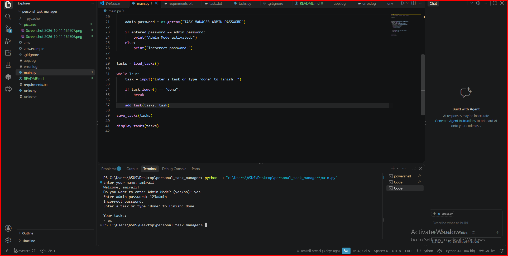

# Personal Task Manager

## Description
Personal Task Manager is a simple command-line application written in Python.
The program allows users to enter and manage personal tasks. Tasks are stored locally so they are still available after the program is closed.
The project also includes an Admin Mode. The admin password is stored securely using an environment variable instead of being written directly inside the Python code.
## Table of Contents
- [Features](#features)
- [Project Structure](#project-structure)
- [File Description](#file-description)
- [Requirements](#requirements)
- [Installation](#installation)
- [Environment Setup](#environment-setup)
- [Usage](#usage)
- [Example Output](#example-output)
- [Screenshots](#screenshots)
- [Demo](#demo)
- [Roadmap](#roadmap)
- [Contributing](#contributing)
- [License](#license)
- [Author](#author)
## Features
- Welcome message for the user
- Add multiple tasks
- Display saved tasks
- Store tasks in a local text file
- Load tasks from previous program runs
- Admin Mode
- Admin password stored using an environment variable
- Private files excluded from Git using `.gitignore`
## Project Structure
```text
personal_task_manager/
├── main.py
├── tasks.py
├── .env.example
├── .gitignore
├── requirements.txt
├── README.md
├── pictures/
└── gifs/
```
Private and generated files such as `.env`, `tasks.txt`, log files, and `__pycache__` are not tracked by Git.
## File Description
| File | Description |
|---|---|
| `main.py` | Runs the main task manager program |
| `tasks.py` | Contains functions for task management and file storage |
| `.env.example` | Shows the required environment variable |
| `.gitignore` | Defines files that should not be tracked by Git |
| `requirements.txt` | Lists the external Python package required by the project |
| `README.md` | Contains project documentation |
## Requirements
- Python 3
- python-dotenv
## Installation
Clone the repository:
```bash
git clone https://github.com/amirali-navaei/personal_task_manager
```

Open the project folder:

```bash
cd personal_task_manager
```

Install the required package:

```bash
pip install -r requirements.txt
```

## Environment Setup

Create a file named:

```text
.env
```

Use `.env.example` as a template.

Example:

```text
TASK_MANAGER_ADMIN_PASSWORD=your_test_password
```

Do not use a real personal password.

The `.env` file is ignored by Git and should not be pushed to GitHub.

## Usage

Run the program with:

```bash
python main.py
```

The program will:

1. Ask for the user's name.
2. Display a welcome message.
3. Ask whether the user wants to enter Admin Mode.
4. Allow the user to add tasks.
5. Save the tasks locally.
6. Display the user's tasks.

## Example Output

```text
Enter your name: Alex
Welcome, Alex!

Do you want to enter Admin Mode? (yes/no): no

Enter a task or type 'done' to finish: Study Python
Enter a task or type 'done' to finish: Finish homework
Enter a task or type 'done' to finish: done

Your tasks:
- Study Python
- Finish homework
```

## Screenshots

### Program Start



### Adding Tasks


### Task Output


## Demo


## Roadmap

Future improvements may include:

- Task priority
- Task status
- Task editing
- Task deletion

## Contributing


## License


## Author

Amirali Navaei
